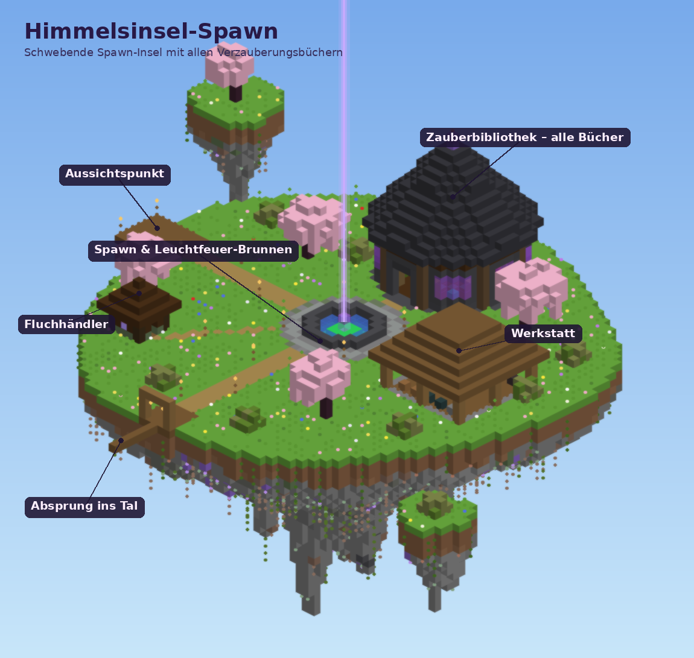

# Himmelsinsel-Spawn

Ein Datapack für **Minecraft Java 1.21.5 bis 26.3** (Vanilla-Server, Paper und Einzelspieler).
Beim ersten Start einer neuen Welt baut es über der Weltmitte eine schwebende Spawn-Insel. Dort gibt es
Händler, die **jedes Verzauberungsbuch auf Höchststufe** verkaufen, an alle Spieler und ohne Ende.



## Was auf der Insel ist

| Ort | Was es dort gibt |
| --- | --- |
| **Spawn & Brunnen** | Hier tauchen neue Spieler auf. Im Brunnen steht ein Leuchtfeuer auf Smaragdblöcken, sein lila Strahl ist von weit her zu sehen |
| **Zauberbibliothek** (Norden) | Runder Turm mit Spitzdach. Acht Händler mit allen Büchern, dazu Bücherwände, Kerzen und ein Kronleuchter |
| **Werkstatt** (Osten) | Zaubertisch mit voller Stufe 30, drei Ambosse (reparieren sich selbst), Schleifstein, Schmiedetisch, Werkbänke, Steinsäge, zwei Endertruhen |
| **Fluchhändler** (Südwesten) | Kleine Hexenhütte mit Braustand. Verkauft die beiden Flüche für je 1 Smaragd |
| **Absprung** (Süden) | Sprungbrett über den Inselrand. Wer springt, bekommt automatisch Sanften Fall und landet heil |
| **Himmelstor** (am Boden) | Landeplatz unter dem Sprungbrett mit einem Endtransitportal: einmal hineinlaufen, schon ist man zurück auf der Insel |
| **Aussichtspunkt** (Westen) | Holzbalkon über dem Abgrund |
| **Mini-Inseln** | Zwei kleine Felsinseln daneben, nur zur Deko |

Die Unterseite der Insel hat hängende Felszapfen mit Tropfstein, Amethyst, Leuchtflechten und
Leuchtbeeren. Sie reicht bis unter die Wolkendecke.

## Installation

### Neue Server-Welt (empfohlen)

1. Server stoppen.
2. In `server.properties` **`spawn-protection=0`** setzen. Sonst dürfen Spieler ohne OP im Umkreis von
   16 Blöcken um den Spawn keine Blöcke benutzen, also auch keine Ambosse und Werkbänke. Die Insel
   schützt sich selbst (siehe unten).
3. Den alten Weltordner (Standard: `world`) wegräumen, damit eine neue Welt entsteht.
4. Den Ordner `world/datapacks/` anlegen und **`Himmelsinsel-Spawn.zip`** hineinlegen. Die Zip nicht entpacken.
5. Server starten. Nach ein paar Sekunden steht im Chat und in der Konsole
   `[Himmelsinsel] Fertig! Die Spawn-Insel schwebt jetzt über x 0 / z 0.`

Das Pack erkennt eine neue Welt daran, dass sie jünger als 5 Minuten ist, und baut dann automatisch.

### Bestehende Welt

1. `Himmelsinsel-Spawn.zip` nach `world/datapacks/` legen, dann `/reload` oder den Server neu starten.
2. Das Pack baut **nicht** von selbst. Im Chat erscheint ein Hinweis.
3. Vorher bedenken, was dabei überschrieben wird:
   - der Luftraum über **x −48 bis 47 / z −48 bis 47** in **Höhe 184 bis 247**
   - am Boden bei **x 0 / z 41** ein Feld von etwa 13 × 13 Blöcken (die Bodenstation). Wenn dort etwas
     steht, die Station vorher abschalten: `/scoreboard players set #bodenstation hs.config 0`
4. Bau starten: `/function himmelsinsel:admin/bauen`

Der Weltspawn wird danach auf die Insel gesetzt.

### Einzelspieler zum Ausprobieren

Neue Welt erstellen → **Datenpakete** → die Zip ins Fenster ziehen → rechts aktivieren → Welt erstellen.

## Händler und Preise

Jedes Buch kostet Smaragde **plus ein normales Buch**. Die Preise steigen nie, die Händler gehen nie aus,
sie bewegen sich nicht und können nicht verletzt werden. In der Bibliothek schwebt über jedem Händler
ein Schild mit seinen Büchern und Preisen, in der Sprache des jeweiligen Spielers.

| Händler | Bücher (Preis in Smaragden) |
| --- | --- |
| **Meister-Bibliothekar** (Mitte, die Bestseller) | Reparatur 20 · Haltbarkeit III 22 · Effizienz V 34 · Glück III 22 · Behutsamkeit 10 · Schärfe V 34 · Schutz IV 28 · Federfall IV 28 · Plünderung III 22 · Stärke V 34 · Unendlichkeit 10 |
| **Werkzeuge** | Effizienz V 34 · Glück III 22 · Behutsamkeit 10 · Haltbarkeit III 22 · Reparatur 20 |
| **Schwert** | Schärfe V 34 · Bann V 34 · Nemesis der Gliederfüßer V 34 · Verbrennung II 16 · Plünderung III 22 · Rückstoß II 16 · Schwungkraft III 22 |
| **Rüstung** | Schutz IV 28 · Feuerschutz IV 28 · Explosionsschutz IV 28 · Schussschutz IV 28 · Dornen III 22 |
| **Bogen & Armbrust** | Stärke V 34 · Schlag II 16 · Flamme 10 · Unendlichkeit 10 · Mehrfachschuss 10 · Durchschuss IV 28 · Schnellladen III 22 |
| **Helm & Stiefel** | Atmung III 22 · Wasseraffinität 10 · Federfall IV 28 · Wasserläufer III 22 · Eisläufer II 22 · Seelenläufer III 28 · Huschen III 28 |
| **Dreizack & Angel** | Harpune V 34 · Treue III 22 · Sog III 22 · Entladung 10 · Glück des Meeres III 22 · Köder III 22 |
| **Streitkolben & Speer** | Dichte V 34 · Durchbruch IV 28 · Windstoß III 28 · Ausfallschritt III 22 (erst ab 1.21.11) |
| **Fluchhändler** (Hütte) | Fluch der Bindung 1 · Fluch des Verschwindens 1 |

Das sind alle 43 Verzauberungen des Spiels, jeweils auf Höchststufe.
Preisformel: 4 + 6 × Stufe, seltene Schatz-Verzauberungen 6 mehr, Reparatur 20, Flüche 1.

## Für alle Spieler

- **Starterpaket:** Beim ersten Join bekommt jeder einmalig volle Eisenrüstung und einen Schild (direkt
  angelegt, wenn die Plätze frei sind), Eisenschwert, -spitzhacke, -axt und -schaufel, einen Bogen mit
  32 Pfeilen, 16 Steaks, einen verzauberten goldenen Apfel und 64 Smaragde. Wer das Paket schon vor
  einer Erweiterung bekommen hat, erhält die neuen Teile beim nächsten Login einmalig nachgeliefert.
- **`/trigger spawn`** bringt dich aus jeder Dimension zurück auf die Insel (30 Sekunden Wartezeit).
  Neue Spieler bekommen beim ersten Betreten einen anklickbaren Link dazu.
- **Runter in die Welt:** vom Sprungbrett springen. Unter der Insel öffnet sich ein „Fallschirm“
  (Sanfter Fall), bis du landest.
- **Hoch auf die Insel:** am Landeplatz ins lila Himmelstor laufen, `/trigger spawn` benutzen oder sterben.
- Wer unter der Insel stirbt (ohne eigenes Bett) oder sich dort ausloggt, landet beim nächsten Mal
  automatisch oben. Mit `#login_spawn = 2` kommt jeder bei jedem Login auf die Insel.

## Schutz der Insel

Auf der Insel (und im Luftraum darum) werden Spieler im Überlebensmodus automatisch in den
**Abenteuermodus** gesetzt. Abbauen und Bauen geht dort nicht, Handeln, Zaubern, Ambosse, Werkbänke und
Endertruhen funktionieren normal. Wer die Insel verlässt, ist sofort wieder im Überlebensmodus.
Spieler im Kreativmodus sind nicht betroffen. Dasselbe gilt für die Bodenstation mit dem Himmelstor
und ein paar Blöcke Rand drumherum.

Außerdem kümmert sich das Pack automatisch um Folgendes:

- Abgenutzte Ambosse werden jede Sekunde durch neue ersetzt.
- Fehlt an der Bodenstation ein Block (etwa nach einer Explosion), wird er innerhalb einer Sekunde
  ersetzt, solange jemand in der Nähe ist.
- Monster, die auf die Insel gelangen, verschwinden.
- Unsichtbare Lichtblöcke verhindern, dass dort nachts Monster spawnen.
- Der Blitzableiter auf der Bibliotheksspitze verhindert, dass ein Blitz Händler in Hexen verwandelt.

## Admin-Befehle

| Befehl | Wirkung |
| --- | --- |
| `/function himmelsinsel:admin/info` | Zeigt alle Einstellungen und ob die Insel fertig gebaut ist |
| `/function himmelsinsel:admin/bauen` | Startet den Bau in einer bestehenden Welt |
| `/function himmelsinsel:admin/neu_bauen` | Baut Insel, Händler und Schilder komplett neu, z. B. wenn etwas kaputt ist |
| `/function himmelsinsel:admin/deinstallieren` | Schaltet alles ab, die Insel bleibt stehen. Danach `/datapack disable "file/Himmelsinsel-Spawn.zip"` |

Einstellungen ändern mit `/scoreboard players set #<name> hs.config <wert>`:

| Name | Standard | Bedeutung |
| --- | --- | --- |
| `spawn_befehl` | 1 | `/trigger spawn` erlaubt (0 = aus) |
| `abklingzeit` | 30 | Sekunden zwischen zwei `/trigger spawn` |
| `schutz` | 1 | Abenteuermodus auf der Insel (0 = aus) |
| `fallschirm` | 1 | Sanfter Fall beim Absprung (0 = aus) |
| `bodenstation` | 1 | Bodenstation beim ersten Bau errichten (0 = nicht bauen) |
| `starterpaket` | 1 | Starterpaket beim ersten Join (0 = aus) |
| `login_spawn` | 1 | Beim Einloggen auf die Insel: 0 = nie, 1 = wer unter der Insel steht, 2 = jeder immer |

## Selbst anpassen

Das Pack wird von einem Python-Programm erzeugt (Ordner `generator/`, braucht nur Python 3):

```bash
cd generator
python3 datapack.py                      # baut ../Himmelsinsel-Spawn.zip neu
python3 vorschau.py ../vorschau.png      # zeichnet das Vorschaubild (braucht Pillow)
```

- `haendler.py`: Händler, Bücher und Preise
- `bauplan.py`: die Insel selbst, Block für Block
- `datapack.py`: Befehle, Bauablauf und Spiellogik
- `pruefen.py`: prüft jeden erzeugten Befehl gegen die offiziellen Befehlsbäume und Register von
  Minecraft 1.21.5, 1.21.10, 1.21.11 und 26.3 (Daten von [misode/mcmeta](https://github.com/misode/mcmeta))

Nach einer Änderung die neue Zip in den Weltordner legen, `/reload` ausführen und
`/function himmelsinsel:admin/neu_bauen` aufrufen.

## Technisches

- Die Insel liegt bei **x 0 / z 0**, die Oberfläche auf **Höhe 224**. Der Spawnpunkt ist **0 225 6**.
- Gebaut wird in 44 Häppchen, eins pro Tick (rund 9 400 Befehle, etwa 43 000 Blöcke). Der Bauplatz wird
  dafür kurz per `forceload` geladen und danach wieder freigegeben.
- Ab 1.21.11 heißen die Gamerules anders und es gibt die Verzauberung Ausfallschritt. Für 1.21.5 bis 1.21.10
  liegt deshalb ein Overlay im Pack, Minecraft wählt automatisch die passende Variante.
